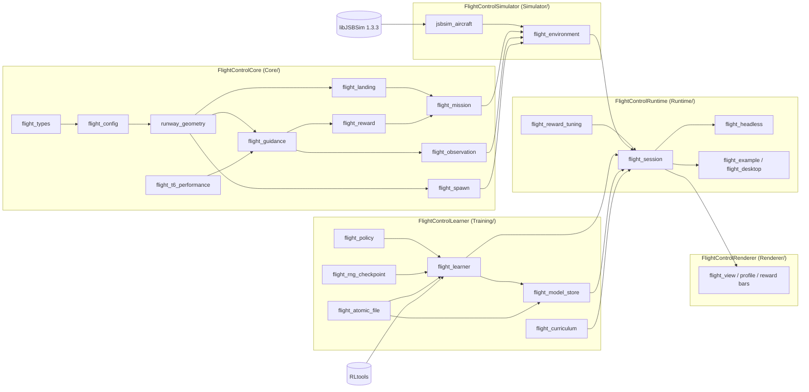
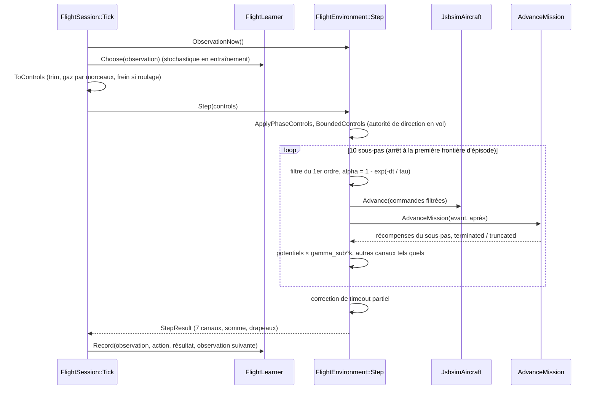
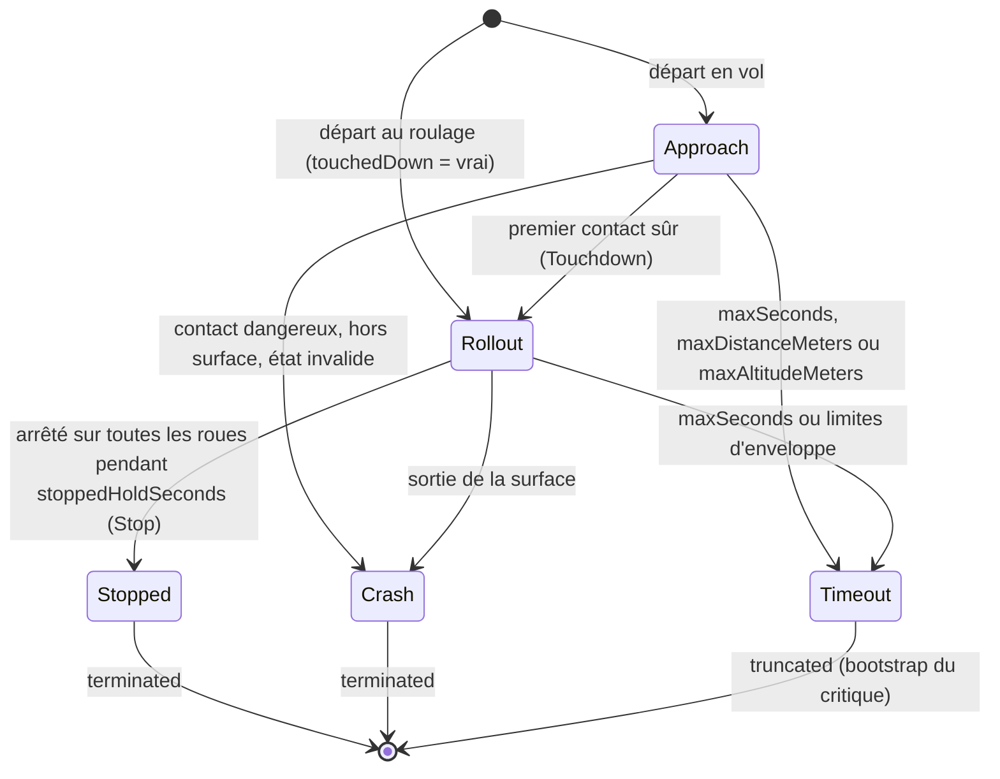
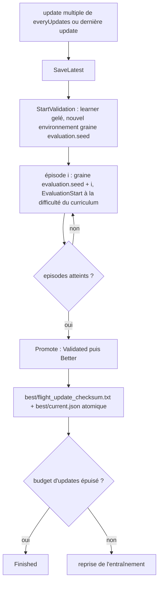

# FlightControl3D : architecture et reprise du code

Ce document décrit `Examples/FlightControl3D` pour un développeur qui découvre le
projet : la carte des modules, le déroulé d'un pas, d'un épisode, d'une update PPO,
d'une validation et du curriculum, puis un glossaire, les tables des constantes, des
récompenses et des observations, et enfin où modifier quoi sans casser les contrats.

Le scénario de référence est `resources/settings/Scenarios/FlightControl3D_T6_Joint.json`.
Les choix de récompense et la procédure CI sont décrits dans
[FlightControl3D T-6 : atterrissage et CI](PPOTrial_FlightControl3D_T6_Approach_CI.md).

## Carte des modules

La chaîne est : **JSBSim → mission → récompense → observation → PPO → session → rendu**.
Chaque dossier est une bibliothèque CMake ; une flèche signifie « dépend de ».

| Module | Fichiers | Ne fait pas |
|---|---|---|
| Core | types, configuration, géométrie, guidage, contact, récompenses, observation, départs, mission | aucun appel JSBSim, aucun réseau |
| Simulator | adaptateur JSBSim, filtre de commande, boucle d'action, resets | aucune politique, aucune statistique |
| Training | politique gaussienne, PPO + GAE (RLtools), checkpoints, BEST, curriculum | aucune physique, aucun ECS |
| Runtime | session (entraînement, validation, inférence), runner headless, pont ECS desktop | aucune formule de récompense |
| Renderer | scène 3D raylib et panneaux ImGui | ne modifie jamais la session |

## Flux d'un pas d'action

Un pas d'action dure `actionSubsteps × physicsDt` = **10 × 0,01 s = 0,1 s**.

Un sous-pas (`AdvanceMission`) suit toujours le même ordre :

1. potentiels Φ(s) de l'état avant le sous-pas ;
2. guidage et détection de contact sur l'état après le sous-pas ; premier contact enregistré ;
3. crash, sinon sortie d'enveloppe (Timeout), sinon coût `Direction`, toucher, roulage, limite de temps ;
4. potentiels Φ(s') (nuls si état absorbant) et ajout de γ_sub·Φ(s') − Φ(s) à chaque canal.

## Cycle d'un épisode

Deux chemins de reset :

- `Reset()` : flux d'entraînement continu. Tirage de Bernoulli `rolloutStartShare` pour
  un départ au roulage ; sinon côté alterné gauche/droite et difficulté
  `niveau × sqrt(u)`, `u` uniforme sur [0, 1] (densité croissante vers le niveau courant).
- `Reset(seed, start)` : épisode autonome reproductible (validation, inférence, tests) ;
  le côté est tiré par Bernoulli(0,5) après la pose de piste.

## Cycle d'une update PPO

1. Collecte de `rolloutSteps` transitions (`Record` évalue V(s) et V(s'), V(s') = 0 si terminé).
2. GAE à rebours : `A_t = δ_t + γλ A_{t+1}`, remise à zéro à chaque frontière d'épisode ;
   `δ_t` garde le bootstrap γV(s') d'une troncature.
3. Normalisation des avantages (moyenne nulle, variance unité, ε = 1e-8).
4. Pour chaque époque : mélange de l'ordre avec le RNG du learner, puis pour chaque minibatch :
   gradient acteur (perte PPO clippée, bonus d'entropie sur les log-std), KL échantillonnée
   et approchée, gradient critique sur (V − cible)² ;
   garde KL : pas d'étape acteur si KL échantillonnée ≥ 1,5 × `targetKl` ; le critique fait
   toujours son étape ; log-std ramenés dans [−3,5 ; −1] ; vérification de finitude.
5. Statistiques de rollout, journal `[FLIGHT_UPDATE]`, fenêtre de diagnostics, réglage de
   récompense en attente appliqué, sauvegarde `latest`, validation si prévue.

## Cycle d'une validation

Pendant une validation, aucune transition n'est enregistrée et le RNG du learner n'est pas
consommé (actions déterministes) : l'entraînement reprend exactement là où il s'était arrêté.

Le plan d'évaluation est stratifié : les `round(rolloutStartShare × N)` premiers épisodes
(au plus N − 1) partent au roulage ; l'épisode en vol k sur n utilise la difficulté
`max × (k + 1) / n`, de sorte que la campagne atteint toujours la frontière du curriculum.

## Curriculum

- Niveau 0 = finale courte alignée (difficulté 0), dernier niveau = enveloppe complète
  (difficulté 1) ; difficulté = niveau / (levels − 1).
- Seuls les épisodes d'entraînement **partis en vol** alimentent la fenêtre.
- Après `windowEpisodes` épisodes, promotion si le taux de Stop ≥ `promotionSuccessRate` ;
  la fenêtre repart vide dans tous les cas.
- Le niveau est sauvegardé dans `latest/curriculum_level.txt` à côté du checkpoint.
- Seule une validation à difficulté 1 peut passer la porte `[FLIGHT_GATE]`.

## Glossaire

| Terme | Définition |
|---|---|
| along | Distance le long de la piste depuis le seuil, en mètres (négative avant le seuil) |
| cross | Écart latéral à l'axe, en mètres, positif à droite |
| height | Hauteur au-dessus du pont, en mètres |
| threshold (seuil) | Début de la piste, origine du repère piste (`along = 0`) |
| aim point | Point d'aboutissement du plan de descente : `thresholdHeightMeters / tan(glideDegrees)` ≈ 286 m |
| glide path | Plan de descente à `glideDegrees` passant à `thresholdHeightMeters` au-dessus du seuil |
| difficulty | Fraction [0, 1] de l'enveloppe de départ en vol (distance interpolée, écarts mis à l'échelle) |
| potential | Fonction Φ(s) d'un canal de shaping ; récompense γΦ(s') − Φ(s) |
| substep | Pas d'intégration JSBSim de `physicsDt` = 0,01 s |
| rollout | (1) phase au sol après le toucher ; (2) lot de `rolloutSteps` transitions PPO |
| termination | Fin absorbante (Stopped, Crash) : V(s') = 0 |
| truncation | Fin par limite (Timeout) : le critique bootstrappe sur V(s') |
| BEST | Génération de checkpoint validée et immuable pointée par `best/current.json` |
| gate | Verdict final `[FLIGHT_GATE]` : validation à difficulté 1 avec au moins `ceil(minimumSuccessRate × épisodes)` Stops |

## Table des constantes

Les valeurs ci-dessous sont dans le code ; le scénario JSON fournit le reste.

| Nom | Valeur | Unité | Fichier | Justification |
|---|---|---|---|---|
| `FeetToMeters` | 0,3048 | m/ft | Core/flight_types.hpp | Pied international exact (JSBSim travaille en pieds) |
| `ObservationSize` | 33 | — | Core/flight_types.hpp | Nombre de slots `ObservationIndex` (contrat) |
| `ContinuousActions` | 5 | — | Core/flight_types.hpp | Profondeur, ailerons, direction, gaz, frein |
| `CentrelineLookaheadMeters` | 300 | m | Core/flight_guidance.hpp | Convergence douce vers l'axe près du point d'aboutissement |
| `MaximumPathAngleDegrees` | 6 | ° | Core/flight_guidance.cpp | Pente commandée maximale (deux fois un plan à 3°) |
| `MaximumContactSinkMps` | 0,5 | m/s | Core/flight_guidance.cpp | Taux de chute visé au contact (toucher doux) |
| `ContactSinkFractionOfLimit` | 0,5 | — | Core/flight_guidance.cpp | Marge sur la limite structurale de chute |
| `FlareSpeedReachedAlongMeters` | −2000 | m | Core/flight_guidance.cpp | Vitesse d'arrondi atteinte 2 km avant le seuil |
| `DecelerationLengthMeters` | 700 | m | Core/flight_guidance.cpp | Décélération smoothstep entre −2,7 km et −2 km |
| `T6ApproachSpeedStallFactor` | 1,3 | — | Core/flight_t6_performance.hpp | Réserve de décrochage 1,3 Vs |
| `T6FlapTravelDegrees` | 30 | ° | Core/flight_t6_performance.hpp | Débattement des volets du T-6 JSBSim |
| `T6InitialMassPounds` | 5500 | lb | Core/flight_t6_performance.hpp | 5000 lb à vide + 500 lb de carburant |
| `T6WingAreaSquareFeet` | 176 | ft² | Core/flight_t6_performance.hpp | Surface de référence du modèle |
| `T6CleanMaximumLiftCoefficient` | 1,47 | — | Core/flight_t6_performance.hpp | CLmax lisse du modèle |
| `SeaLevelDensity` | 1,225 | kg/m³ | Core/flight_t6_performance.hpp | Atmosphère standard au niveau de la mer |
| `VerticalSpeedErrorScaleMps` | 2 | m/s | Core/flight_reward.hpp | Saturation du potentiel `VerticalSpeed` |
| `AirspeedErrorScaleMps` | 10 | m/s | Core/flight_reward.hpp | Saturation du potentiel `Speed` en vol |
| `TouchdownZoneLengthMeters` | 900 | m | Core/flight_reward.hpp | Zone de toucher OACI |
| `MaximumSpeedPenaltyFraction` | 0,5 | — | Core/flight_reward.cpp | Perte maximale du `Touchdown` pour excès de vitesse |
| `DirectionCostScale` | 0,5 | — | Core/flight_reward.cpp | Ramène 1 − cos(angle) ∈ [0, 2] dans [0, 1] |
| `MovingDirectionMinimumSquaredLength` | 0,5 | — | Core/flight_reward.cpp | Distingue un vecteur unitaire du vecteur nul |
| `InitialWheelClearanceMeters` | 2,5 | m | Core/flight_spawn.cpp | Hauteur initiale d'un départ au roulage avant pose |
| `StrutCompressionMeters` | 0,001 | m | Simulator/flight_environment.cpp | Évite la frontière ambiguë hauteur = 0 |
| `KnotsToMetersPerSecond` | 1852/3600 | (m/s)/kt | Simulator/jsbsim_aircraft.cpp | Nœud international |
| `EarthSemiMajor` / `EarthSemiMinor` | 6378137 / 6356752,314245179 | m | Simulator/jsbsim_aircraft.cpp | Ellipsoïde WGS84 |
| `MinimumLogStandardDeviation` | −3,5 | — | Training/flight_policy.hpp | σ ≈ 0,03 : exploration minimale |
| `InitialLogStandardDeviation` | −2 | — | Training/flight_policy.hpp | σ ≈ 0,14 autour de l'approche trimée |
| `MaximumLogStandardDeviation` | −1 | — | Training/flight_policy.hpp | σ ≈ 0,37 : évite la saturation des commandes |
| `MaximumAbsoluteLogRatio` | 20 | — | Training/flight_policy.hpp | exp(20) reste fini ; garde-fou numérique |
| `KlSkipFactor` | 1,5 | — | Training/flight_learner.cpp | Garde KL alignée sur RLMission |
| `AdvantageEpsilon` | 1e-8 | — | Training/flight_learner.cpp | Stabilité de la normalisation des avantages |
| `CheckpointMagic` | `PPO_FLIGHT_POLICY_V3` | — | Training/flight_learner.cpp | Format de checkpoint (contrat) |
| `ContractVersion` | 5 | — | Core/flight_config.cpp | Version de la sémantique observation/action/récompense |
| `EvaluationProtocolVersion` | 3 | — | Training/flight_model_store.cpp | Protocole de validation stratifié |

Les échelles d'observation sont listées dans la table des observations ci-dessous.

## Table des récompenses

Les poids viennent de `reward.weights` (valeurs du scénario de référence entre parenthèses).

| Canal | Type | Phase | Formule (non pondérée) | Saturation |
|---|---|---|---|---|
| Path (4) | potentiel | vol + sol | vol : `tol / (tol + d)`, `tol = pathTolerance` (1500 m), `d` = distance au point d'aboutissement puis écart latéral et hauteur au-delà ; sol : 1 | ∈ (0, 1] |
| Direction (0,5) | coût continu | vol | `−dt × (1 − cos(angle vitesse/commande)) / 2` par sous-pas | ∈ [−dt, 0] |
| VerticalSpeed (2) | potentiel | vol | `−min(|vz − vz_cible| / 2 m/s, 1)` ; sol : 0 | ∈ [−1, 0] |
| Speed (2) | potentiel | vol + sol | vol : `−min(|CAS − cible| / 10 m/s, 1)` ; sol : `1 − min(v / flareSpeed, 1)` | vol [−1, 0], sol [0, 1] |
| Touchdown (5) | événement | premier contact sûr | zone × aire × (1 − (chute/max)²) × (1 − 0,5 × excès de vitesse) | ∈ [0, 1] |
| Stop (10) | événement | arrêt confirmé | facteur d'aire du point de toucher | ∈ [0, 1] |
| Crash (−5) | événement | tout crash | 1 | — |

Les potentiels contribuent γ_sub·Φ(s') − Φ(s) par sous-pas, actualisés par γ_sub^k dans
l'action ; un état absorbant a un potentiel nul ; un Timeout garde le sien, et une action
tronquée en cours reçoit la correction (γ − γ_sub^exécutés)·Φ(s).

## Table des observations

Toutes les valeurs sont dans [−1, 1]. `SignedLog(x, r, M) = sign(x)·log(1 + |x|/r) / log(1 + M/r)`.

| # | Nom | Grandeur | Normalisation |
|---|---|---|---|
| 0 | along | distance au seuil | SignedLog, r = 100 m, M = 20 km |
| 1 | cross | écart latéral | SignedLog, r = 10 m, M = 5 km |
| 2 | height | hauteur au-dessus du pont | SignedLog, r = 5 m, M = 2 km |
| 3 | glide_path_error | hauteur − plan de descente | SignedLog, r = 5 m, M = 500 m |
| 4 | runway_remaining | (longueur − along) / longueur | borné |
| 5–7 | velocity_forward/right/up | vitesse relative au pont, axes piste | / 80, / 20, / 10 m/s |
| 8 | airspeed_error | CAS − CAS cible | / 10 m/s |
| 9 | vertical_speed_error | vz − vz cible | / 5 m/s |
| 10–12 | roll_sin, roll_cos, pitch_sin | attitude | sinus / cosinus |
| 13–14 | heading_sin, heading_cos | cap relatif à la piste | sinus / cosinus |
| 15–17 | roll/pitch/yaw_rate | vitesses angulaires | / 0,5 rad/s |
| 18–20 | target_direction_body_* | direction commandée, axes avion | vecteur unitaire |
| 21–23 | velocity_direction_body_* | direction de la vitesse, axes avion | vecteur unitaire |
| 24 | weight_on_wheels | poids sur les roues | 0 ou 1 |
| 25 | rollout | phase de roulage (active le frein) | 0 ou 1 |
| 26 | stop_progress | temps arrêté / stoppedHoldSeconds | borné |
| 27 | elapsed | temps simulé / maxSeconds | borné |
| 28–32 | filtered_* | commandes filtrées appliquées | déjà bornées |

## Reprendre le code

| Je veux… | Où | Invariants et tests qui protègent la zone |
|---|---|---|
| Changer un poids de récompense | JSON `reward.weights` (ou panneau desktop) | `ValidateReward`, `reward_tests`, signature de contrat (warm start autorisé, BEST revalidé) |
| Changer une formule de récompense | `Core/flight_reward.cpp` | **Change le modèle** : nouvelle `ContractVersion`, `reward_tests`, `simulator_tests` (ActionLevelPotential), golden trace |
| Ajouter/retirer une observation | `Core/flight_observation.*` | **Change le contrat** : `ObservationSize`, checkpoint, `ContractVersion`, `core_tests`, golden trace |
| Modifier le guidage | `Core/flight_guidance.cpp` | `core_tests` (AimPointOnRunway, ApproachDirection, FlareTrajectory), signature (mission) |
| Modifier les critères de crash | `Core/flight_landing.cpp`, `Core/flight_mission.cpp` (`Crashed`) | `core_tests` (Landing, CrashDiagnostics), `simulator_tests` |
| Modifier les départs ou le curriculum | `Core/flight_spawn.cpp`, `Training/flight_curriculum.cpp` | ordre des tirages aléatoires, `core_tests` (Spawns, CurriculumSpawns, EvaluationStratification), `session_tests`, golden trace |
| Toucher à l'adaptateur JSBSim | `Simulator/jsbsim_aircraft.cpp` | conventions d'unités/repères/signes, `simulator_tests`, golden trace |
| Modifier PPO | `Training/flight_policy.hpp`, `Training/flight_learner.cpp` | `learner_tests` (gradients par différences finies, KL), format de checkpoint, golden trace |
| Changer un journal ou un CSV | `Runtime/flight_session.cpp`, `Runtime/flight_headless.cpp` | parsés par `tools/flight/curriculum_ci.py` et la CI : `python -m unittest tools/flight/test_curriculum_ci.py` |
| Changer l'affichage | `Renderer/` | lecture seule du `FlightSnapshot` ; `display_tests` (build desktop) |

Le test `FlightControl_golden_trace_tests` (`tests/golden_trace_tests.cpp`) calcule une
empreinte FNV-1a 64 de tout le comportement (épisodes seedés, 7 canaux, frontières,
2 updates PPO, signature, octets du checkpoint). Une refonte ne doit jamais la changer ; un
changement volontaire du modèle doit être fait dans une PR séparée qui met à jour la
référence et explique pourquoi. La référence n'est appliquée que sur Linux x86_64 /
GCC 13 / libstdc++ ; ailleurs le test est signalé « skipped » (code 77).
