# Architecture des réseaux Blue

Ce schéma décrit le chemin réellement compilé de `GeneralizedPatrolMappoAgent`.
Il montre les familles d'entrées, les réseaux, leurs sorties et la boucle
d'apprentissage, sans détailler chaque index de l'observation.

```mermaid
flowchart LR
    ECS["État ECS du monde"] --> BUILD["BuildGeneralizedObservations<br/>observation v10 · 295 float par Bleu"]

    BUILD --> DIRECT["État propre · rôle<br/>LiDAR · guidage · P/N"]
    BUILD --> REDS["Pistes rouges<br/>masque N"]
    BUILD --> TEAM["Pistes alliées + objectif<br/>masque P"]

    REDS --> RED_ATT["Attention rouge masquée<br/>encodeur tanh 13 → 8<br/>contexte + moyenne + maximum = 24"]
    TEAM --> TEAM_ATT["Attention alliés/objectif masquée<br/>encodeur tanh 9 → 6<br/>contexte + moyenne + maximum = 18"]

    DIRECT --> COMPACT["Observation acteur compacte<br/>156 float"]
    RED_ATT --> COMPACT
    TEAM_ATT --> COMPACT

    subgraph EXEC["Acteur partagé · exécution décentralisée"]
        ACTOR["GeneralizedAttentionActor<br/>MLP gaussien partagé<br/>156 → 128 ReLU → 128 ReLU → 2 linéaires"]
        POLICY["Sorties politique<br/>μ rotation · μ accélération<br/>+ log_std appris en entraînement"]
        SELECT["Entraînement : échantillon gaussien<br/>Inférence : moyenne μ"]
    end

    COMPACT --> ACTOR --> POLICY --> SELECT
    SELECT --> CLAMP["Saturation [-1, 1]"]
    CLAMP --> COMMANDS["Commandes ECS<br/>m_rotSpeedCmd · m_accCmd"]
    COMMANDS --> PHYSICS["FlightModelSystem<br/>accélérations physiques"]

    COMPACT --> OWN["Observation compacte<br/>du Bleu évalué · 156"]
    COMPACT -->|"P observations compactes"| POOL["Pooling des Bleus vivants<br/>moyenne 156 + maximum 156"]
    ECS --> FRACTIONS["Fraction vivante + P initial<br/>2 valeurs"]

    OWN --> CRITIC_INPUT["Entrée critic centralisée<br/>470 float"]
    POOL --> CRITIC_INPUT
    FRACTIONS --> CRITIC_INPUT

    subgraph TRAIN["Critic et apprentissage · entraînement uniquement"]
        CRITIC["GeneralizedCriticConfig::Network<br/>MLP de valeur centralisé<br/>470 → 256 ReLU → 256 ReLU → 1 linéaire"]
        VALUE["V(équipe, blue_i)<br/>1 valeur par trajectoire"]
        ROLLOUT["Rollout<br/>actions · log-probabilités · valeurs<br/>reward total · terminal/troncature"]
        PPO["GeneralizedPatrolLearner<br/>PPO / MAPPO · GAE"]
    end

    CRITIC_INPUT --> CRITIC --> VALUE --> ROLLOUT
    SELECT -->|"action + log-probabilité"| ROLLOUT
    REWARDS["Rewards Blue<br/>15 canaux → agrégation pondérée"] --> ROLLOUT
    ROLLOUT --> PPO
    PPO -. "mise à jour des poids" .-> ACTOR
    PPO -. "mise à jour des poids" .-> CRITIC

    classDef input fill:#eaf3ff,stroke:#31679a,color:#102a43;
    classDef network fill:#fff2cc,stroke:#9a6b00,color:#3d2b00;
    classDef output fill:#e8f7ee,stroke:#2f7d4a,color:#173d25;
    classDef training fill:#f3eaff,stroke:#7550a5,color:#302040;
    class BUILD,DIRECT,REDS,TEAM,OWN,POOL,FRACTIONS,REWARDS input;
    class RED_ATT,TEAM_ATT,ACTOR,CRITIC network;
    class POLICY,SELECT,CLAMP,COMMANDS,PHYSICS,VALUE output;
    class ROLLOUT,PPO training;
```

## Lecture rapide

- **Acteur** : `GeneralizedAttentionActor`, attention masquée suivie d'un MLP
  gaussien partagé. Il reçoit 156 valeurs et produit deux commandes normalisées.
- **Critic** : `GeneralizedCriticConfig::Network`, MLP centralisé conditionné par
  le Bleu évalué. Il reçoit 470 valeurs et produit une estimation de valeur.
- **Type d'apprentissage** : MAPPO avec CTDE, donc critic centralisé pendant
  l'entraînement et acteur décentralisé pendant l'exécution.
- **Production** : seuls l'adaptateur d'observation, l'acteur, la saturation et
  la physique sont utilisés. Le critic, les rewards et PPO ne sont pas exécutés.

Les dimensions exactes, le mapping des 15 rewards et les points d'entrée du
code sont détaillés dans le [guide d'adaptation de l'agent Blue](../adapter-agent-blue.md).

