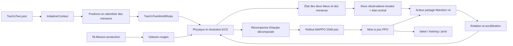
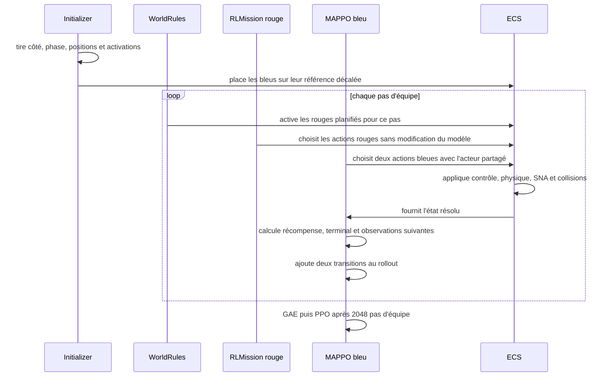

# Architecture et feuille de route de la patrouille bleue

Date de référence : 26 octobre 2026.

## 1. Objet du document

Ce document décrit l'architecture de l'entraînement `BluePatrol`/`two-vs-two`,
les changements introduits pour apprendre une véritable patrouille coopérative
et la stratégie recommandée pour poursuivre les améliorations.

Le point essentiel pour la suite n'est pas d'augmenter immédiatement la taille
du réseau ou la durée d'entraînement. Il faut d'abord rendre les comportements
mesurables, étendre l'évaluation déterministe, puis faire progresser le
curriculum selon les résultats. Sans cette boucle, une récompense moyenne en
hausse peut masquer une patrouille qui se resserre, deux voitures qui poursuivent
la même menace ou une politique qui oublie les épisodes sans rouge.

## 2. Périmètre et invariants

Le travail concerne le contrôleur bleu MAPPO/RLTools avec attention et le
rollout applicatif configuré à 2048 pas d'équipe.

Les invariants actuels sont les suivants :

- C++17 ;
- un seul `PatrolMappoAgent` coordonne les deux défenseurs ;
- acteur partagé et décentralisé, critique centralisé pendant l'entraînement ;
- 156 valeurs dans l'observation complète : 124 locales et 32 privilégiées ;
- 2 actions normalisées par voiture : rotation et accélération ;
- contrat de checkpoint bleu v4 inchangé ;
- les rouges utilisent toujours le modèle `RLMission` de production existant ;
- aucun fichier `.pt`, aucune observation et aucune action de `RLMission` ne
  sont modifiés ;
- les campagnes d'évaluation restent déterministes et ne tirent pas le
  curriculum aléatoire.

## 3. Vue d'ensemble



### Responsabilités principales

| Élément | Responsabilité |
| --- | --- |
| `Defenders/data/patrol_core.hpp` | Géométrie, observations, affectation des menaces et récompenses pures |
| `Defenders/src/patrol_team_agent.cpp` | Adaptation ECS, collecte jointe, terminaison et pilotage du learner |
| `data/spawn.hpp`, `src/spawn.cpp` | Positions initiales et calendrier reproductible d'activation |
| `src/twovstworules.cpp` | Activation au bon pas, collisions et résolution du monde |
| `Defenders/data/patrol_learner.hpp` | Buffer on-policy, GAE, PPO, acteur partagé et critique centralisé |
| `Training/BluePatrol.json` | Rollout, limites d'entraînement, évaluation et poids de récompense |
| `Scenarios/TwoVsTwo.json` | Géométrie et probabilités du curriculum de menaces |
| `Platforms/Mobile/defender_car.json` | Limites physiques des voitures bleues |

## 4. Cycle d'un épisode d'entraînement



Une menace différée existe physiquement dans l'ECS, mais reste détruite et sa
piste d'attention est entièrement masquée. Elle est réactivée avant l'inférence
du pas prévu. Si la première menace est détruite et qu'une seconde est encore
planifiée, l'épisode continue et le bonus de victoire n'est pas accordé trop tôt.

## 5. Curriculum de menaces

La configuration distribuée produit :

- 20 % d'épisodes sans menace ;
- 35 % avec une menace ;
- 45 % avec deux menaces ;
- 35 % de probabilité de retarder la première menace ;
- 70 % de probabilité de décaler la seconde lorsqu'elle existe.

Avec le pas ECS actuel de 0,2 seconde :

- la première menace retardée apparaît entre les pas 256 et 768, soit entre
  51,2 et 153,6 secondes ;
- la seconde reçoit un délai supplémentaire de 384 à 1024 pas, soit de 76,8 à
  204,8 secondes après la première.

Le choix de l'index `red_1` ou `red_2` activé en premier est mélangé. Le réseau
ne peut donc pas apprendre qu'un emplacement fixe de l'observation est toujours
la menace prioritaire.

Les évaluations désactivent ce curriculum et utilisent les cas immédiats 2v1
et 2v2 existants. Cela rend les scores comparables entre deux checkpoints.

## 6. Patrouille en hippodrome

Le circuit suit l'axe est/ouest. Les lignes droites couvrent plus de 80 % de
chaque demi-longueur disponible. Les demi-tours restent à l'intérieur du monde
avec un rayon complet de marge par rapport à la frontière.

Dans la géométrie distribuée :

- le circuit mesure environ 138 km ;
- un épisode de 4096 pas à 300 m/s représente environ 1,78 tour ;
- le leader possède une avance d'environ 9,6 km sur le suiveur ;
- la file reste sur la même trajectoire, y compris dans les demi-tours.

La référence avance avec l'horloge d'équipe. Chaque voiture reçoit sa propre
erreur de position, de cap, de progression et de vitesse. Le suivi utilise une
échelle locale proche du rayon du circuit, et non les dimensions complètes du
monde : une erreur de quelques kilomètres produit maintenant un signal
d'apprentissage significatif.

## 7. Récompenses et rôles

Les sept canaux visibles dans l'interface sont conservés afin de ne pas casser
la configuration ni la télémétrie.

### Sans menace

- les deux voitures suivent leur référence respective ;
- `Formation safety` combine la marge anticollision et l'erreur de pose
  relative leader–suiveur ;
- l'ordre de la file et l'écart longitudinal sont donc appris, pas imposés par
  un contrôleur déterministe à l'inférence.

### Avec une menace

- le défenseur le plus proche reçoit l'affectation d'interception ;
- son équipier reste en patrouille de réserve ;
- le rapprochement de l'intercepteur et le maintien de la réserve donnent des
  signaux complémentaires.

### Avec deux menaces

- l'affectation un-à-un minimise la somme des distances ;
- les deux voitures sont libérées de la référence de patrouille ;
- chaque défenseur est récompensé lorsqu'il devient plus proche de sa cible que
  son équipier ;
- un terme borné récompense l'écartement de l'équipe afin d'éviter que les deux
  voitures suivent le même danger.

Les échecs graves restent terminaux : collision bleue, perte d'un défenseur,
perte de l'objectif ou sortie au-delà de la limite de sécurité dure.

## 8. Dynamique des défenseurs

Les limites rétablies sont :

- vitesse de croisière initiale : 300 m/s ;
- vitesse maximale : 700 m/s ;
- accélération maximale : 600 m/s² ;
- vitesse de rotation maximale : environ 40,1°/s, soit 0,7000006 rad/s ;
- domaine SNA : destruction garantie dans les 5 km avant et engagement
  possible jusqu'à 10 km.

Le modèle peut donc ralentir, accélérer et tourner fortement. La récompense de
suivi plus locale doit lui apprendre à employer ces capacités, notamment pour
rattraper la référence après une interception et négocier les demi-tours.

## 9. Checkpoints et compatibilité

Le checkpoint actuel est conservé.

- son acteur possède toujours le contrat v4 attendu ;
- il est chargé avec succès par les scénarios réels ;
- le checkpoint complet n'est qu'à la mise à jour 15 sur 300 ;
- il constitue donc un warm-start utile et peut encore s'adapter aux nouvelles
  récompenses et à la nouvelle géométrie.

Il ne faut pas supprimer `prod` pour essayer un entraînement neuf. La procédure
sûre est d'archiver `latest`, de conserver `prod` comme référence, puis de créer
une expérience explicitement nommée. La suppression n'est justifiée que si les
métriques montrent plusieurs évaluations consécutives sans adaptation ou une
divergence reproductible du critique.

## 10. Limites actuelles

Les limites importantes à traiter avant d'agrandir le réseau sont :

1. le score d'évaluation agrège encore trop de comportements dans une seule
   valeur ;
2. les campagnes de combat couvrent 2v1/2v2 immédiats, mais pas encore les
   épisodes sans menace et les activations différées ;
3. l'affectation est recalculée depuis l'état courant et peut osciller lorsque
   les deux défenseurs sont presque équidistants ;
4. la consigne de vitesse reste constante sur le circuit ; elle ne demande pas
   explicitement de ralentir avant un demi-tour puis de réaccélérer ;
5. une récompense d'équipe identique pour les deux trajectoires peut rendre le
   crédit individuel ambigu ;
6. les probabilités du curriculum sont fixes et ne dépendent pas du niveau
   atteint ;
7. les métriques de saturation des commandes et de temps de réaction ne sont
   pas encore publiées.

## 11. La clé pour aller plus loin

La priorité doit être la boucle suivante :

```text
mesurer -> évaluer sur des cas fixes -> modifier une seule hypothèse
        -> entraîner -> comparer -> promouvoir ou revenir en arrière
```

Faire simplement davantage de mises à jour PPO ne permet pas de savoir si la
politique s'améliore réellement comme patrouille.

### Étape P0 — Instrumentation avant nouveau réglage

Ajouter à l'évaluation et aux snapshots :

- erreur moyenne, médiane et 95e percentile de suivi ;
- erreur absolue d'écart leader–suiveur ;
- nombre d'inversions de l'ordre leader/suiveur ;
- distance minimale entre défenseurs ;
- fraction de temps où deux menaces ont deux défenseurs distinctement affectés ;
- délai entre activation d'une menace et engagement effectif ;
- temps de destruction et distance minimale menace–objectif ;
- fraction de commandes de rotation ou d'accélération saturées ;
- vitesse moyenne sur ligne droite et dans les zones de demi-tour ;
- taux de collision, de perte d'objectif et de timeout par famille de scénario.

Ces métriques doivent être exportables en JSON ou CSV par checkpoint et par
graine. Elles permettent ensuite de comparer deux expériences sans jugement
visuel subjectif.

### Étape P0 — Matrice d'évaluation déterministe

Créer des campagnes fixes et séparées :

| Famille | Cas recommandés |
| --- | --- |
| Patrouille pure | deux côtés, quatre phases, au moins deux tours |
| Une menace immédiate | menace frontale, nord, sud, proche de chaque défenseur |
| Une menace différée | activation sur ligne droite et juste avant un demi-tour |
| Deux menaces immédiates | approches symétriques, croisées et fortement asymétriques |
| Deux menaces décalées | seconde menace avant, pendant et après la première interception |
| Robustesse | variations de position, vitesse rouge et zone restreinte |

Le score global peut rester visible, mais chaque famille doit aussi avoir son
propre taux de succès. Une régression en patrouille pure ne doit pas être
masquée par une meilleure interception.

### Étape P1 — Curriculum progressif

Remplacer les probabilités fixes par des phases basées sur les évaluations :

1. patrouille pure jusqu'à stabilité de l'écart et du suivi ;
2. mélange patrouille + une menace immédiate ;
3. ajout d'une menace différée ;
4. ajout de deux menaces immédiates ;
5. ajout des menaces décalées et de la randomisation complète.

Chaque phase doit conserver 15 à 25 % des cas précédents pour limiter l'oubli
catastrophique. Le passage à la phase suivante doit dépendre d'un seuil
d'évaluation, pas uniquement du nombre de mises à jour PPO.

Cette évolution peut rester compatible v4 : elle modifie la distribution des
épisodes, pas le réseau.

### Étape P1 — Profil de vitesse réellement dynamique

La prochaine amélioration comportementale recommandée est un profil de vitesse
lié à la courbure :

- vitesse de croisière élevée sur la ligne droite ;
- réduction progressive à l'approche du demi-tour ;
- vitesse cible plus faible sur l'arc ;
- réaccélération après la sortie du virage ;
- rattrapage borné après une interception, sans dépasser le suiveur ou le
  leader attendu.

`distanceToTurn` est déjà observé. Une première version peut donc ajouter un
façonnage de vitesse dépendant de cette valeur sans modifier la taille de
l'observation. Il faudra toutefois versionner explicitement la sémantique si la
valeur « vitesse cible » présente dans l'observation remplace la vitesse de
croisière constante.

### Étape P1 — Affectation stable des menaces

Ajouter une hystérésis de rôle au niveau du domaine :

- conserver l'affectation courante tant que le gain d'un échange reste faible ;
- échanger seulement si la nouvelle affectation réduit suffisamment le coût ;
- libérer immédiatement un défenseur lorsque sa cible est détruite ;
- conserver l'affectation uniquement dans la récompense et le critique tant
  qu'elle n'est pas exposée à l'acteur.

Cette stabilité réduit les changements de cible contradictoires sans imposer
les actions des voitures. Elle reste compatible avec l'objectif : le réseau
apprend toujours à piloter.

### Étape P2 — Crédit d'équipe plus précis

Si les deux voitures continuent à reproduire le même comportement, comparer :

- la récompense d'équipe actuelle ;
- une récompense mixte, par exemple 70 % équipe et 30 % rôle local ;
- un avantage contrefactuel mesurant l'apport de chaque défenseur.

Il faut conserver un objectif d'équipe dominant pour éviter qu'un intercepteur
sacrifie l'objectif au profit de sa récompense locale.

### Étape P2 — Robustesse et diversité

Randomiser progressivement, sans modifier `RLMission` :

- vitesse et cap initiaux des rouges ;
- angle et distance d'apparition ;
- position de la zone restreinte ;
- phase initiale et petites erreurs de formation des bleus ;
- délais d'activation ;
- paramètres physiques bleus dans une plage étroite de tolérance.

Cette randomisation doit être ajoutée après la réussite des cas déterministes,
sinon elle rend le diagnostic de convergence inutilement difficile.

### Étape P3 — Nouveau contrat seulement si le v4 plafonne

Un modèle v5 peut être envisagé uniquement après mesure d'un plafond clair.
Options possibles :

- mémoire récurrente légère pour raisonner sur l'historique des menaces ;
- indicateur explicite d'affectation ou d'état de rôle ;
- prédiction auxiliaire du temps d'interception ;
- encodeur de piste plus large ou attention multi-tête ;
- critique enrichi avec les affectations persistantes.

Ces changements modifient la sémantique ou la dimension du réseau. Ils doivent
utiliser de nouveaux noms de checkpoint et ne jamais écraser les modèles v4.

## 12. Critères d'acceptation proposés

Les seuils suivants sont des objectifs initiaux. Ils doivent être ajustés après
mesure du checkpoint v4 actuel sur la nouvelle matrice.

| Indicateur | Cible initiale |
| --- | ---: |
| Survie en patrouille pure | >= 99 % |
| Fraction de pas avec suivi correct | >= 95 % |
| Erreur P95 de l'écart de formation | <= 20 % de l'écart cible |
| Inversions leader/suiveur | < 1 par épisode |
| Collision entre bleus | < 1 % des épisodes |
| Une menace : succès de protection | >= 85 % |
| Deux menaces : affectations distinctes | >= 90 % des pas d'engagement |
| Deux menaces : succès de protection | >= 75 % |
| Régression admise sur une famille déjà validée | <= 2 points |

Un checkpoint ne doit être promu que s'il améliore le score principal sans
franchir une limite de sécurité ou de régression par famille.

## 13. Plan d'implémentation recommandé

### Prochaine livraison

1. ajouter la télémétrie P0 ;
2. étendre l'évaluateur aux cinq familles de scénarios ;
3. enregistrer un rapport JSON par checkpoint ;
4. mesurer `prod` et `latest` sans réentraînement ;
5. fixer les seuils à partir de cette baseline ;
6. seulement ensuite lancer la reprise à partir de la mise à jour 15.

### Livraison suivante

1. introduire les phases de curriculum ;
2. ajouter l'hystérésis d'affectation ;
3. tester le profil de vitesse de virage ;
4. comparer chaque changement séparément à la baseline.

### Décision de version

- rester en v4 tant que les améliorations concernent récompense, curriculum,
  métriques ou logique d'évaluation ;
- créer v5 uniquement pour une nouvelle observation, une mémoire récurrente ou
  une architecture d'acteur différente.

## 14. Validation actuelle

La livraison décrite dans ce document est validée en Debug x64, plateforme
imposée par la configuration CMake actuelle :

```powershell
ctest --test-dir out/build/x64-Debug -C Debug `
  -R "TwoVsTwo|BluePatrol" --output-on-failure
```

Résultat : 10 tests sur 10 réussis. La suite couvre notamment le spawn, les
activations différées, les collisions balayées, la géométrie de patrouille,
l'attention masquée, une mise à jour PPO, les deux scénarios ECS et les
évaluateurs.

