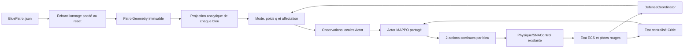
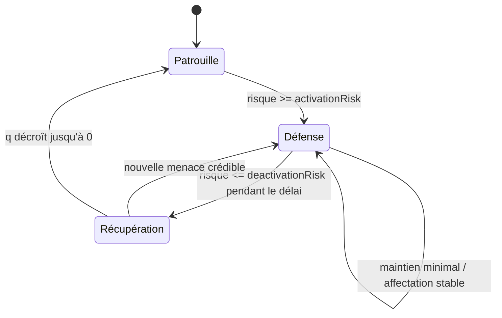

# Patrouille bleue v5 : hippodrome continu, wedge et défense

## Décision principale

La patrouille v5 n'utilise aucun waypoint. L'hippodrome est une courbe
analytique fermée composée de deux droites et de deux demi-cercles. Chaque
bleu reçoit des mesures locales lui permettant de comprendre où il se trouve,
dans quel sens progresser et comment retrouver sa formation. Le réseau reste
seul à produire `m_rotSpeedCmd` et `m_accCmd`.

La famille de circuits par défaut mesure 50 à 60 km de long et 16 à 20 km de
large. Cette largeur maintient des virages progressifs, y compris pour la
courbe intérieure du follower décalée par le wedge.

Ce contrat impose un nouvel entraînement. Les dimensions de tenseur sont
restées stables, mais leur sémantique a changé : un acteur v4 ne doit donc pas
être repris. Les checkpoints bleus sont désormais :

- acteur : `blue_patrol_mappo_v5.txt`, magie `BLUE_PATROL_MAPPO_V5` ;
- état complet : `blue_patrol_training_v2.txt`, magie
  `BLUE_PATROL_TRAINING_V2`.

Les fichiers v4/v1 ne sont ni supprimés ni chargés. Les modèles rouges
RLMission ne sont pas modifiés.

La plateforme bleue reprend la dynamique de `trainingaircraft` : vitesse
maximale 700 m/s, accélération 600 m/s², rotation 0,7000006 rad/s et domaine
SNA `MaxShootAngle` de 3,147198 rad. La vitesse de croisière ajoutée pour la
patrouille reste 300 m/s. Le système SNA historique conserve ses règles : la
destruction garantie à moins de 5 km reste limitée au demi-plan avant, tandis
que le domaine angulaire étendu agit sur la probabilité hors de cette garantie.

## Flux d'exécution



Le `DefenseCoordinator` choisit seulement un rôle et une menace stable. Il ne
calcule aucune commande de véhicule. Le suffixe centralisé reste masqué dans
l'Actor et n'est visible que par le Critic pendant l'entraînement CTDE.

## Géométrie et invariants

`PatrolGeometry` contient l'ancrage nord/est, le cap de l'axe majeur, la
longueur et la largeur hors tout, la distance et l'angle du wedge, et le sens
du parcours. L'angle du wedge est mesuré depuis l'arrière du leader vers
l'intérieur :

```text
back    = separationDistance × cos(separationAngle)
inward  = separationDistance × sin(separationAngle)
```

Le follower utilise sa propre courbe intérieure et un retard curviligne. Les
rôles leader/follower ne sont jamais permutés aux demi-tours. Une géométrie
n'est acceptée que si :

- les valeurs sont finies, `min <= max` et les unités sont explicites ;
- longueur hors tout > largeur hors tout > 0 ;
- le rayon et le rayon intérieur respectent `R >= v / omega_max` ;
- les deux courbes restent dans le monde avec la marge configurée ;
- la séparation minimale reste supérieure à la distance de collision ;
- le nombre borné de tentatives n'est pas dépassé.

Une seed identique donne le même épisode. `min == max` produit une géométrie
déterministe. Un échec de tirage est une erreur explicite, jamais un fallback.

## Contrat Actor v5

Chaque observation contient 156 flottants : 124 locaux et 32 réservés à
l'état centralisé. L'Actor masque les 32 derniers. Les 10 entrées locales de
patrouille sont :

| Index | Valeur |
| ---: | --- |
| 0–1 | cosinus/sinus de la tangente désirée relativement au cap propre |
| 2 | erreur latérale signée normalisée |
| 3–4 | sinus/cosinus de la phase projetée sur le tour |
| 5 | courbure de prévisualisation normalisée par le rayon de virage minimal |
| 6–7 | erreurs longitudinale et intérieure du wedge |
| 8 | rôle fixe : -1 leader, +1 follower |
| 9 | poids continu de défense `q` dans `[0,1]` |

Les pistes rouges conservent leurs slots masqués. Une entrée locale globale
encode en plus la menace affectée au bleu : 0 sans affectation, 0,5 pour le
slot rouge 0 et 1 pour le slot rouge 1. Il n'existe ni index de waypoint, ni
point cible, ni progression imposée par une horloge.

Les deux sorties restent :

1. vitesse de rotation normalisée, appliquée à `m_rotSpeedCmd` ;
2. accélération longitudinale normalisée, appliquée à `m_accCmd`.

## Patrouille, défense et récupération

Le risque d'un rouge combine distance à l'objectif, fermeture, temps estimé
avant intrusion, pénétration et vulnérabilité d'un coéquipier poursuivi.



Avec une menace crédible, un seul bleu est choisi selon le coût d'interception
et l'autre reste en réserve. Avec deux menaces, l'affectation un-à-un minimise
le coût total. Une nouvelle affectation doit respecter la durée minimale et
apporter l'amélioration configurée. Quand la menace disparaît, `q` décroît
pendant `recoverySeconds` ; la reward de wedge revient progressivement.

## Récompenses et terminaisons

Les sept canaux GUI restent inchangés :

- `Patrol tracking` : progression signée physiquement réalisée et erreur
  latérale, pondérées par `(1-q)` ;
- `Formation safety` : wedge pondéré par `(1-max(q))`, avec séparation et
  collision toujours actives ;
- `Control effort` : commandes absolues bornées ;
- `Zone protection` : fermeture vers les menaces affectées, couverture,
  pénétration et sortie douce du monde ;
- `Interception` : destruction hostile comptée une fois ;
- `Mission outcome` : destruction bleue/objectif prioritaire, puis victoire ;
- `Timeout` : menace non résolue à l'horizon.

Une patrouille sans rouge se termine par troncature à l'horizon, sans victoire
instantanée. La simple intrusion n'est pas terminale. La destruction d'un
bleu, de l'objectif ou une collision bleu–bleu reste un échec.

## Configuration JSON

`resources/settings/Training/BluePatrol.json` contient :

- `patrol.racetrack` : intervalles longueur, largeur, cap et ancrage, sens,
  marge et nombre maximal de tentatives ;
- `patrol.formation` : intervalles de distance et d'angle du wedge ;
- `patrol.defense` : risques d'activation/désactivation, distances, temps
  d'intrusion, vulnérabilité du coéquipier, temporisations et seuil de gain
  avant changement d'affectation ;
- `rewards.shaping` : échelles du progrès, de l'erreur latérale, du wedge, de
  la séparation et de l'effort ;
- `training`, `evaluation` et les sept poids de récompense existants.

Toutes les distances sont en mètres, les durées en secondes et les angles du
JSON en degrés. Le domaine les convertit en radians à la lecture.

## Visualisation TwoVsTwo

Le contexte d'épisode échantillonne 97 points de rendu par courbe une seule
fois au reset. Ces points sont publiés uniquement dans le snapshot TwoVsTwo et
n'ont aucune sémantique de navigation. La case `Show patrol track`, visible
uniquement dans la vue tactique TwoVsTwo, affiche les deux courbes et leur sens
en 3D et sur la minimap. Elle fonctionne pour `blueController: "mappo"` et
`blueController: "reference"`.

## Responsabilités des fichiers

| Fichier | Responsabilité |
| --- | --- |
| `Defenders/Core/data/patrol_geometry.hpp` | courbe, projection, validation et tirage |
| `Defenders/Core/data/patrol_defense.hpp` | risque, hystérésis et affectations stables |
| `Defenders/Core/data/patrol_core.hpp` | observations, rewards et contrats purs |
| `Defenders/Runtime/src/patrol_team_agent.cpp` | adaptation ECS et transitions MAPPO |
| `src/initializer.cpp` | tirage unique au reset et échantillons visuels |
| `src/twovstworules.cpp` | collisions, activation des rouges et snapshot |
| `Airspace/Renderer/src/environmentrenderer.cpp` | option visuelle conditionnelle |

## Validation reproductible

Depuis un terminal VS2022 configuré :

```powershell
cmake --build out/build/x64-Debug --config Debug --target PPO -j 4
ctest --test-dir out/build/x64-Debug -C Debug -R "TwoVsTwo|BluePatrol" --output-on-failure
out/build/x64-Debug/Main/Debug/PPO.exe --example blue-patrol --check-example
out/build/x64-Debug/Main/Debug/PPO.exe --example two-vs-two --check-example
```

Les tests ciblent notamment les seeds, bornes et géométries impossibles, la
projection continue, les sauts de phase, le recul, le wedge, la collision sous
menace, la crédibilité des rouges, l'hystérésis, les affectations 1/2 menaces,
le coéquipier poursuivi, la récupération et la publication de l'overlay.
