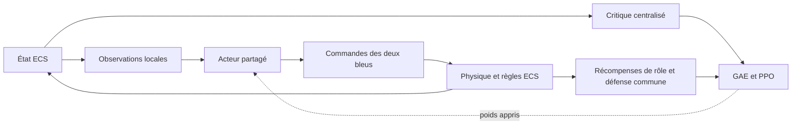

# Patrouille bleue v7 : rôles et défense apprise

Ce document conserve son chemin historique v6 et décrit le contrat courant v7.

## Responsabilités

À chaque épisode, les deux voitures reçoivent une permutation aléatoire
bijective : exactement un leader et un équipier. Le leader suit l'unique
hippodrome analytique. L'équipier tient une pose arrière/intérieure relativement
au cap physique du leader, sans être projeté sur l'hippodrome.

Un acteur partagé produit séparément les deux commandes continues de chaque
bleu. Le critique centralisé apprend la valeur des états d'équipe pendant
l'entraînement ; les avantages GAE entraînent les deux politiques locales.
Aucun coordinateur, index de cible ou commande d'interception externe
n'intervient dans l'exécution.

## Observations et pooling

Chaque observation contient 156 flottants : 124 locaux et 32 centralisés.
Le suffixe centralisé est masqué avant chaque passage dans l'acteur.

| Entrées locales de patrouille | Contenu |
| --- | --- |
| 0–5 | Leader uniquement : tangente, erreur latérale, phase, courbure |
| 6–7 | Équipier uniquement : erreurs longitudinale et intérieure du wedge |
| 8 | Rôle : -1 leader, +1 équipier |
| 9 | Pression défensive commune, dans [0, 1] |

Le dernier champ global local est réservé à zéro. Un numéro de slot rouge
serait ambigu après pooling invariant à l'ordre des pistes ; aucun numéro
de cible n'est donc injecté.

Les deux bleus reçoivent toutes les pistes rouges actives, y compris hors du
rectangle visible. L'encodeur, l'attention masquée et les poolings moyen/maximum
restent identiques. Seules les pistes absentes ou détruites sont masquées.

## Défense et récompenses

La pression est calculée sans mémoire d'affectation à partir du risque des
rouges : distance à l'objectif, fermeture, intrusion et vulnérabilité des bleus.
Elle vaut au moins 0,25 lorsqu'un rouge est actif. Le profil utilise 90 km et
300 s ; ces paramètres pondèrent la priorité de mission et ne filtrent jamais
les pistes ni la récompense de poursuite.

Avec un seul rouge, le wedge reste actif. Avec plusieurs rouges simultanés,
le poids de wedge vaut `1 - pression`. La séparation de sécurité reste active
dans tous les cas. Le suivi du leader vaut également `1 - pression`.

Les sept canaux publiés dans l'IHM sont :

- `Patrol tracking` : suivi d'hippodrome du leader uniquement ;
- `Formation safety` : erreur de wedge de l'équipier et sécurité commune ;
- `Control effort` : commandes propres à chaque voiture ;
- `Zone protection` : poursuite, couverture, objectif et limites souples,
  récompensés de façon commune aux deux bleus ;
- `Interception` : +10 par rouge détruit, partagé ;
- `Mission outcome` : échec prioritaire, puis victoire coopérative ;
- `Timeout` : -15 si une menace reste à l'horizon.

Le coût de poursuite additionne la distance au rouge et un effort de mise en
cap. Pour deux rouges, le reward évalue le minimum des deux couvertures
possibles. Cet appariement existe seulement dans le calcul du score et n'est
ni conservé ni communiqué aux acteurs. Son amélioration entre deux pas donne
le signal dense de progression. La distance résiduelle est pénalisée, de sorte
qu'un bleu immobile face au rouge ne reçoive pas de bonus permanent.

Le wedge est mesuré dans le repère du cap réel du leader. Sa pénalité
`erreur / (1 + erreur)` reste sensible au rapprochement au-delà d'une distance
de séparation. Le coefficient global actuel vaut 4, le coefficient d'erreur
2 et la tolérance 3 %.

## Géométrie, curriculum et cinématique

Un seul hippodrome de 50–60 km sur 16–20 km est tiré au reset, avec sa pose,
son sens et le wedge de 6–9 km à 10–25°. Le rayon respecte la contrainte
`R >= vitesse / rotation_max` et les poses échantillonnées restent dans le monde.
L'overlay affiche uniquement cette piste du leader.

Le curriculum active deux rouges dans 80 % des épisodes, un dans 15 % et
aucun dans 5 %. Toutes les menaces sont immédiates. Les rouges utilisent
toujours leurs modèles RLMission de production.

L'avantage bleu reste local : croisière et maximum à 800 m/s, accélération
600 m/s², rotation alignée sur `trainingaircraft` à 0,7000006 rad/s.
Il ne fait l'objet d'aucun nouveau commit.

## Checkpoints et limites de validation

L'acteur est `blue_patrol_mappo_v7.txt` avec signature `BLUE_PATROL_MAPPO_V7`.
La reprise complète est `blue_patrol_training_v4.txt` avec signature
`BLUE_PATROL_TRAINING_V4`. Elle restaure acteur, critique, états Adam,
compteur et RNG. Un rollout repris démarre vide.

Les anciens checkpoints v6/v3 restent sur disque et sont ignorés. La première
exécution v7 repart de poids neufs : cette correction du contrat ne garantit
pas un comportement tactique déjà appris.

Les collisions sous 1 km, destructions bleues/objectif et limites de sécurité
restent terminales. Une patrouille sans rouge atteint l'horizon sans victoire
instantanée. Les seuils de risque ne détruisent ni ne cachent aucun rouge.

## Organisation

| Fichier | Responsabilité |
| --- | --- |
| `Core/data/patrol_geometry.hpp` | Courbe, projection et échantillonnage |
| `Core/data/patrol_defense.hpp` | Évaluation stateless du risque, sans affectation |
| `Core/data/patrol_core.hpp` | Observations et rewards coopératifs |
| `Runtime/src/patrol_team_agent.cpp` | Adaptateur ECS et collecte jointe |
| `Training/data/patrol_learner.hpp` | Acteur, critique, GAE et PPO |
| `Training/data/attention_actor.hpp` | Attention et pooling masqués, inchangés |
